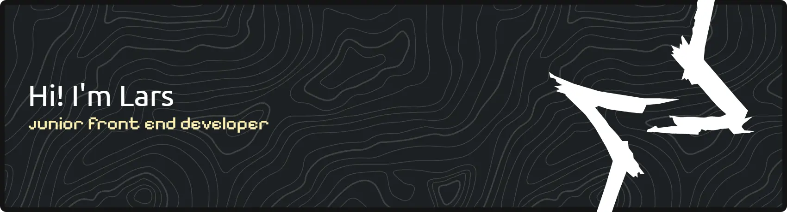

  

<h1 align="center">Lars Torp Pettersen</h1>

  
  

## About me

Junior front-end developer based in Oslo, Norway. I build thoughtful, responsive interfaces with a background in cinematography and design.

I'm looking for my first junior front-end role, freelance opportunities, and interesting projects. I'm open to teams in Oslo, remote-friendly companies, and collaborations involving thoughtful interface work.

Fagskole-educated (120 study points) at [Noroff School of Technology and Digital Media](https://www.noroff.no/en).

## Tech stack

  

  <a href="mailto:github.enviably914@passinbox.com">✉️ Get in touch</a>
  ·
  <a href="https://larstp.com">🌐 Visit my portfolio</a>

---

  
<strong>Selected projects</strong>

| Project                                                | What it is                                                                                                                           |
| ------------------------------------------------------ | ------------------------------------------------------------------------------------------------------------------------------------ |
| **[GcG Trading Platform](https://gcg.slovstuggu.com)** | A card trading platform for my local Gundam GCG group, focused on deck-building and trading via Discord. Work in progress |
| **[Holidaze](https://holidaze.larstp.com)**            | An online travel booking and venue management website. Front End Exam                                                     |
| **[Mimir](https://mimir.larstp.com)**                  | A social platform built around API integration and CRUD functionality. School Assignment                                  |
| **[Barter](https://barter.larstp.com)**                | An online auction house experience. School Assignment                                                                     |
| **[Butta](https://butta.larstp.com)**                  | An online e-commerce platform. School Assignment                                                                          |

<picture>
  <source media="(prefers-color-scheme: dark)" srcset="https://raw.githubusercontent.com/larstp/larstp/output/github-contribution-grid-snake-dark.svg" />
  <source media="(prefers-color-scheme: light)" srcset="https://raw.githubusercontent.com/larstp/larstp/output/github-contribution-grid-snake.svg" />
  
</picture>
